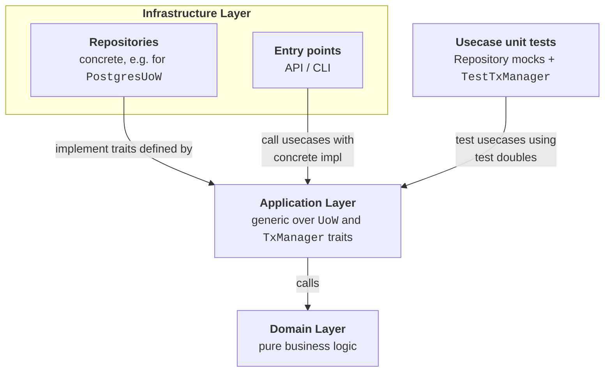

# uow

A lightweight set of traits for the Unit of Work pattern in Rust.

Use `uow` when you want your application layer to stay ignorant of the database
backend, and you want to test business logic without spinning up a real database.

## Table of contents

- [What problem it solves](#what-problem-it-solves)
- [Features](#features)
- [Quick start](#quick-start)
  - [1. Define a repository trait generic over `UoW`](#1-define-a-repository-trait-generic-over-uow)
  - [2. Implement a usecase with the `transaction!` macro](#2-implement-a-usecase-with-the-transaction-macro)
  - [3. Test with `TestTxManager`](#3-test-with-testtxmanager)
- [Design notes](#design-notes)
  - [The `transaction!` macro and the method it calls](#the-transaction-macro-and-the-method-it-calls)
  - [Why the closure returns `(UoW, Result)`](#why-the-closure-returns-uow-result)
  - [Isolation level fallback chaining](#isolation-level-fallback-chaining)
- [Example application](#example-application)
- [License](#license)

## What problem it solves

In onion, clean, and domain-driven architectures, the application layer depends
on abstractions, not concrete infrastructure. The concrete database type never
appears in application code. `uow` enables this by separating the transaction
boundary from business logic. Your usecases acquire a generic Unit of Work from
a `TxManager` and pass it to repositories.



*Dependency direction in onion architecture. The application layer depends on
abstractions (traits). The infrastructure layer contains concrete
implementations and entry points. Tests sit outside the layers and call
usecases with mocked dependencies.*

`uow` gives you three traits that define roles in transaction handling:

- **`UoW`**: defines the Unit of Work role. Carries the error type for a concrete
  transaction backend. Repository methods accept `&mut U` where `U: UoW` to
  receive the active transaction handle.
- **`TxManager`**: defines the transaction boundary role. Acquires a unit of work,
  runs your logic inside it, and auto-commits on success or rolls back on failure.
  Acquiring the unit of work begins a transaction in the database.
- **`IsolationLevelSelector`**: defines the isolation configuration role. Lets you
  request an isolation level and chain fallbacks if the platform does not support it.

Your repository traits are generic over `U: UoW` and accept `&mut U` instead of
`&mut SqliteConnection` or `&mut PgConnection`. The compiler resolves these traits
at compile time, so the abstraction carries no runtime cost. Your usecases call
`tx_manager.transaction(...)` and remain independent of the database backend. Your unit tests use `TestTxManager` from the `test-utils`
feature and assert that commits and rollbacks happen when you expect them.

`UoW` carries an associated `Error` type that ties repository methods to the
backend they run on. Concrete implementations such as `SqliteUoW` or
`PostgresUoW` wrap an active database transaction. Commit and rollback live on
`TxManager`, not on `UoW`.

## Features

| Feature            | What it enables                                      |
|--------------------|------------------------------------------------------|
| `test-utils`       | `TestTxManager` and `TestUoW` for unit tests         |
| `sqlx-sqlite`      | `SqliteTxManager` and `SqliteUoW` via SQLx           |
| `sqlx-postgresql`  | `PostgresTxManager` and `PostgresUoW` via SQLx       |

Add to `Cargo.toml`:

```toml
[dependencies]
uow = { version = "0.0.1", features = ["sqlx-sqlite"] }
```

## Quick start

### 1. Define a repository trait generic over `UoW`

```rust
use async_trait::async_trait;
use uow::UoW;

pub struct AccountId(i64);

#[async_trait]
pub trait AccountsRepository<U: UoW>: Clone + Send + Sync {
    async fn get_account(
        &self,
        uow: &mut U,
        account_id: AccountId,
    ) -> Result<Option<Account>, MyStorageError<U>>;

    async fn save_account(
        &self,
        uow: &mut U,
        account: &Account,
    ) -> Result<(), MyStorageError<U>>;
}
```

The trait is generic over `U` so the same interface works with `SqliteUoW`,
`PostgresUoW`, and `TestUoW`.

### 2. Implement a usecase with the `transaction!` macro

```rust
use uow::{transaction, IsolationLevel, IsolationLevelSelector, TxManager, UoW};

pub struct TransferUsecase<M, R>
where
    M: TxManager,
    R: AccountsRepository<M::UoW>,
{
    tx_manager: M,
    repo: R,
}

impl<M, R> TransferUsecase<M, R>
where
    M: TxManager,
    R: AccountsRepository<M::UoW>,
{
    pub async fn execute(
        &self,
        from: AccountId,
        to: AccountId,
        amount: i64,
    ) -> Result<(), MyAppError<M::UoW>> {
        let result = transaction!(
            self.tx_manager
                .isolated_at(IsolationLevel::Serializable)
                .if_platform_supports()?,
            |mut uow| async {
                let mut from_acc = self.repo.get_account(&mut uow, from).await?
                    .ok_or(MyAppError::AccountNotFound(from))?;
                let mut to_acc = self.repo.get_account(&mut uow, to).await?
                    .ok_or(MyAppError::AccountNotFound(to))?;

                // Domain logic lives in the domain layer.
                // The usecase only orchestrates the transaction boundary.
                domain::transfer(&mut from_acc, amount, &mut to_acc)?;

                self.repo.save_account(&mut uow, &from_acc).await?;
                self.repo.save_account(&mut uow, &to_acc).await?;

                Ok(())
            }
        )
        .await;

        match result {
            Ok(Ok(())) => Ok(()),
            Ok(Err(app_err)) => Err(app_err),
            Err(tx_err) => {
                // tx_err is TransactionError<M::UoW>.
                match tx_err {
                    uow::TransactionError::BeginFailed(e) => {
                        // The transaction could not start.
                        // You may retry here with a backoff strategy, or propagate.
                        Err(MyAppError::Storage(e.into()))
                    }
                    uow::TransactionError::CommitFailed(e) => {
                        // Serializable isolation may detect a conflict between concurrent
                        // transactions and fail the commit. You may retry here, or propagate.
                        Err(MyAppError::Storage(e.into()))
                    }
                    uow::TransactionError::RollbackFailed(e) => {
                        // The transaction failed and could not roll back.
                        // This is usually propagated immediately; retries are rarely useful.
                        Err(MyAppError::Storage(e.into()))
                    }
                }
            }
        }
    }
}
```

`Serializable` isolation prevents lost updates by detecting when concurrent
transactions touch the same rows. If the database detects a conflict, the
commit fails. Retry the entire `transaction!` call outside the closure when
this happens.

The `transaction!` macro wraps your body in an inner `async` block, awaits it,
and returns `(uow, result)` so the manager can commit or roll back. You do not
need to write that boilerplate yourself.

### 3. Test with `TestTxManager`

Enable the `test-utils` feature and write fast unit tests:

```rust
use uow::test_utils::{TestTxManager, TestUoW};
use uow::TxManager;

#[tokio::test]
async fn transfer_commits_on_success() {
    let tx = TestTxManager::new();
    let repo = MockAccountsRepository::new()
        .with_account(Account::new(1, 100))
        .with_account(Account::new(2, 50));

    let usecase = TransferUsecase::new(tx.clone(), repo);

    let result = usecase.execute(AccountId(1), AccountId(2), 30).await;
    assert!(result.is_ok());

    assert_eq!(tx.transactions_started(), 1);
    assert_eq!(tx.transactions_committed(), 1);
    assert_eq!(tx.transactions_rolled_back(), 0);
}

#[tokio::test]
async fn transfer_rolls_back_when_domain_invariant_fails() {
    let tx = TestTxManager::new();
    let repo = MockAccountsRepository::new()
        .with_account(Account::new(1, 20))   // sender has only 20
        .with_account(Account::new(2, 50));

    let usecase = TransferUsecase::new(tx.clone(), repo);

    // Domain logic rejects: insufficient funds.
    let result = usecase.execute(AccountId(1), AccountId(2), 30).await;
    assert!(matches!(result, Err(MyAppError::TransferFailed(_))));

    // Transaction rolled back because the closure returned Err.
    assert_eq!(tx.transactions_started(), 1);
    assert_eq!(tx.transactions_committed(), 0);
    assert_eq!(tx.transactions_rolled_back(), 1);
}
```

`TestTxManager` tracks how many transactions started, committed, and rolled
back. You can assert that your error propagation reaches the transaction
framework.

## Design notes

### The `transaction!` macro and the method it calls

The quick-start examples use the `transaction!` macro. It expands into a call
to `TxManager::transaction` with an inner `async` block:

```rust
tx_manager.transaction(|mut uow| async {
    let r = async { /* your body */ }.await;
    (uow, r)
})
```

The inner `async` block exists only to make your logic return a single value.
Since the outer closure must return `(UoW, Result)`, the inner block borrows
`uow` instead of moving it. This lets the closure construct the tuple after
your body completes.

You are free to call `TxManager::transaction` directly, even without the inner
`async` block, and return the tuple yourself. You might do this when the inner
block is not desired, or when you aim to keep macro usage to a minimum in your
project.

### Why the closure returns `(UoW, Result)`

Rust does not yet have stable async closures that borrow their arguments across
await points without lifetime issues. `TxManager::transaction` takes a
`FnOnce(UoW) -> Fut` closure. The closure owns the `UoW`, runs your logic, and
returns both the `UoW` and the `Result`. The manager then decides whether to
commit or roll back. The `transaction!` macro hides this tuple return from you.

### Isolation level fallback chaining

Not every database supports every isolation level. You can chain preferences:

```rust
self.tx_manager
    .isolated_at(IsolationLevel::RepeatableRead)
    .or(IsolationLevel::Serializable)
    .if_platform_supports()?
```

If `RepeatableRead` is unsupported, the selector tries `Serializable`. If none
match, it returns `IsolationLevelNotSupportedError`.

## Example application

The `examples/balance-transfer` directory contains a small axum service that
transfers credits between accounts. It shows the full onion architecture:

- **Domain**: pure functions, no external dependencies.
- **Application**: usecases that orchestrate repositories through `UoW`.
- **Infrastructure**: concrete `SqliteRepository` and `SqliteTxManager`.
- **API**: axum handlers that call usecases and map errors to HTTP responses.

Run it with:

```bash
just run-sqlite
```

## License

Licensed under either of

- Apache License, Version 2.0
- MIT license

at your option.
